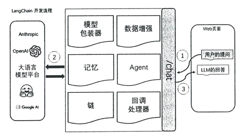
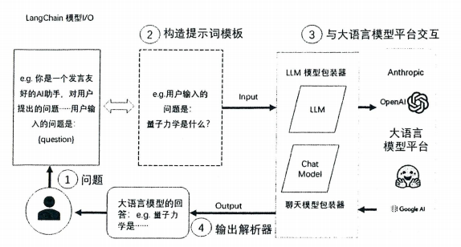
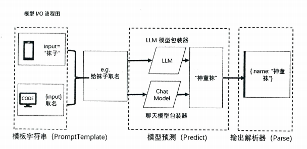
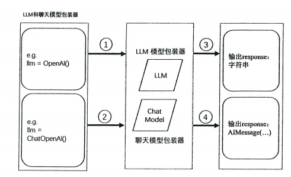
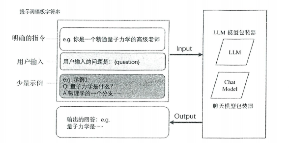

参考
《LangChain 入门指南构建高可复用、可扩展的 LLM 应用程序》

---

# 使用场景
## 2个关键
设计与开发，以“组件”和“链”为关键概念
## 3个场景
1.问答系统
2.数据处理与管理
3.自动问答与客服机器人

# 6大模块
1. 模型I/O（ModelIO）：对于任何大语言模型应用来说，其核心无疑都是模型
自身。LangChain提供了与任何大语言模型均适配的模型包装器（模型I/O的功能），
分为LLM和聊天模型包装器（ChatModel）。模型包装器的提示词模板功能使得开
发者可以模板化、动态选择和管理模型输人。LangChain自身并不提供大语言模型，
而是提供统一的模型接口。模型包装器这种包装方式允许开发者与不同模型平台底层
的API进行交互，从而简化了大语言模型的调用，降低了开发者的学习成本。此外，
其输出解析器也能帮助开发者从模型输出中提取所需的信息。
2. 数据增强（DataConnection）：许多LLM应用需要的用户特定数据并不在模
型的训练集中。LangChain提供了加载、转换、存储和查询数据的构建块。开发者可
以利用文档加载器从多个来源加载文档，通过文档转换器进行文档切割、转换等操作。
矢量存储和数据检索工具则提供了对嵌人数据的存储和查询功能。
3. 链（Chain）：单独使用LLM对于简单应用可能是足够的，但面对复杂的应用，
往往需要将多个LLM模型包装器或其他组件进行链式连接。LangChain为此类“链式”
应用提供了接口。
4. 记忆（Memory）：大部分的LLM应用都有一个对话式的界面，能够引用之前
对话中的信息是至关重要的。LangChain提供了多种工具，帮助开发者为系统添加记
忆功能。记忆功能可以独立使用，也可以无缝集成到链中。记忆模块需要支持两个基
本操作，即读取和写入。在每次运行中，链首先从记忆模块中读取数据，然后在执行
核心逻辑后将当前运行的输人和输出写人记忆模块，以供未来引用。
5. Agent：核心思想是利用LLM选择操作序列。在链中，操作序列是硬编码的，
而在Agent代理中，大语言模型被用作推理引擎，确定执行哪些操作，以及它们的执
行顺序。
6. 回调处理器（Callback）：LangChain提供了一个回调系统，允许开发者在LLM
应用的各个阶段对状态进行干预。这对于日志记录、监视、流处理等任务非常有用。
通过API提供的callbacks参数，开发者可以订阅这些事件。
# 开发流程


# 模型IO

## 3个核心功能
1. 模型包装器：通过接口调用大语言模型，见图中的模型预测（Predict）部分。

2. 提示词模板管理：将用户对LLM的输人进行模板化，并动态地选择和管理这些
模板，即模型输人（ModelI），见图中的模板字符串（PromptTemplate）部分。
3. 输出解析器：从模型输出中提取信息，即模型输出（Model0），见图中的
输出解析器（Parse）部分。
## 模型包装器
### 分类
1. 通用的LLM模型包装器；
2. 是专门针对Chat 类型API的Chat Model（聊天模型包装器）。
3. 
#### LLM模型包装器
LLM模型包装器是一种专门用于与大语言模型文本补全类型API交互的组件。
这种类型的大语言模型主要用于接收一个字符串作为输人，然后返回一个补全的字符
串作为输出。比如，你可以输人一个英文句子的一部分，然后让模型生成句子的剩余
部分。这种类型的模型非常适合用于自动写作、编写代码、生成创意内容等任务。

2023年7月，LangChain已经实现了6个针对不同模型平台的聊天模型包装器：
1. ChatOpenAI：用于包装OpenAIChat大语言模型（如GPT-4和GPT-3.5-
Turbo）;
2. AzureChatOpenAI:用于包装Azure平台上的OpenAI模型;
3. PromptLayerChatOpenAI:用于包装PromptLayer平台上的OpenAI模型;
4. ChatAnthropic：用于包装Anthropic平台上的大语言模型;
5. ChatGooglePalm：用于包装 Google Palm平台上的大语言模型;
6. ChatVertexAI:用于包装VertexAI平台上的大语言模型，VertexAI的PaLMAPI
中包含了Google 的Pathways Language Model 2（PaLM 2）的发布端点。

聊天模型包装器都是BaseChatModel的子类，继承了BaseChatModel的所有属性
和方法，并根据需要添加或覆盖一些自己的方法。

#### LLM模型包装器
LLM模型包装器是LangChain的核心组件之一。LangChain不提供自己的大语言
模型，而是提供与许多不同的模型平台进行交互的标准接口。

#### 聊天模型包装器
为了使用聊天模型包装器，这里将导人3个数据模式（schema）：一个由AI生
成的消息数据模式（AIMessage）、一个人类用户输人的消息数据模式
（HumanMessage）、一个系统消息数据模式（SystemMessage）。这些数据模式通常
用于设置聊天环境或提供上下文信息。

```
from langchain.schema import (
AIMessage,
HumanMessage,
SystemMessage
」
from langchain.chat_models import ChatOpenAI
```
### 提示词模板
提示词模板中可能包含（不是必须包含）以下3个元素。
1. 明确的指令：这些指令可以指导大语言模型理解用户的需求，并按照特定的方
式进行回应，见图3-5中的“明确的指令”。
2. 少量示例：这些示例可以帮助大语言模型更好地理解任务，并生成更准确的响
应，见图中的“少量示例”。
3. 用户输人：用户的输人可以直接引导大语言模型生成特定的答案，见图中
的“用户输人”。

#### PromptTemplate 包装器
```
from langchain import PromptTemplate
template "
You are an expert data scientist with an expertise in building deep
Learning models. Explain the concept of (concept) in a couple of lines
..…
#实例化模板的第一种方式：
prompt = PromptTemplate(template-template, input_variables=["concept"])
#实例化模板的第二种方式：
# prompt = PromptTemplate.from_template(template)
#将用户的输人通过format方法嵌人提示词模板，并且做格式化处理
final_prompt = prompt.format (concept-"NLP")
```
#### ChatPromptTemplate 包装器
ChatPromptTemplate包装器与PromptTemplate包装器不同，ChatPromptTemplate
包装器构造的提示词是消息列表，支持输出Message对象。LangChain提供了内置的
聊天提示词模板（ChatPromptTemplate）和角色消息提示词模板。角色消息提示词模
板包括 AIMessagePromptTemplate、SystemMessagePromptTemplate 和 HumanMessage
PromptTemplate 这 3 种。
```commandline
from langchain.prompts import(
ChatPromptTemplate,
PromptTemplate,
SystemMessagePromptTemplate,
AIMessagePromptTemplate,
HumanMessagePromptTemplate,
)
```
#### 少样本提示词模板 FewShotPromptTemplate 类
```commandline
few_shot_prompt = FewShotPromptTemplate（
examples=examples,
example_prompt=example_prompt,
example_separator="\n",
prefix="来玩个反义词接龙游戏，我说词语，你说它的反义词\n"，
suffix="词语:{input}\n反义词: ",
input_variables=["input"],
）
```
```commandline
来玩个反义词接龙游戏，我说词语，你说它的反义词
词语：高
反义词：矮
词语：胖
反义词：
瘦
词语：
精力充沛
反义词：
萎靡不振
词语：廿
快乐
反义词：
伤心
词语：鼎
黑
反义词：白
```
## 输出解析器
### 功能
添加提示词模板的输出指令和解析输出格式。
1. BooleanOutputParser：用于解析布尔值类型的输出。
2. CommaSeparate ListOutputParser：用于解析以逗号分隔的列表类型的输出。
```commandline
from langchain.output_parsers import CommaSeparatedListOutputParser
from langchain.prompts import PromptTemplate
from langchain.llms import OpenAI
output_parser = CommaSeparatedListOutputParser ()

format_instructions = output_parser.get_format_instructions()
prompt = PromptTemplate(
template="List five (subject).In{format_instructions)",
input_variables=["subject"],
partial_variables-("format_instructions": format_instructions)
)

from langchain.chains import LLMChain
chain = LLMChain(
    llm=OpenAI(
    openai_api_key="填人 OpenAI 的密钥"
    ),
    prompt=prompt
)
output = chain("ice cream flavors")
output_parser.parse(output['text'])

# 最后得到的结果是一个包含5种冰淇淋口味的列表，代表口味的值用逗号隔开：
['Vanilla',
'Chocolate',
'Strawberry',
'Mint Chocolate Chip',
'Cookies and Cream']
```
3. DatetimeOutputParser：用于解析日期时间类型的输出。
4. EnumOutputParser：用于解析枚举类型的输出。
5. ListOutputParser：用于解析列表类型的输出。
6. PydanticOutputParser：用于解析符合Pydantic大语言模型需求的输出。
```commandline
parser = PydanticOutputParser (pydantic_object-Joke)
prompt = PromptTemplate(
template="Answer the user query.In(format_instructions)In(query)n",
input_variables=["query"),
partial_variables=("format_instructions":
parser.get_format_instructions ()),
D
_input = prompt.format_prompt (query-joke_query)
output = model(_input.to_string ()
parser.parse (output)
```
7. StructuredOutputParser：用于解析具有特定结构的输出。
## 结构化输出解析器 StructuredOutputParser