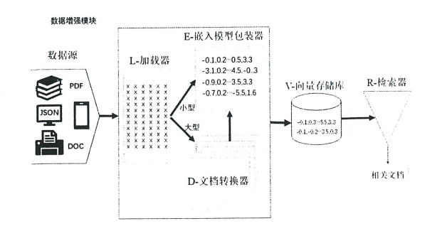
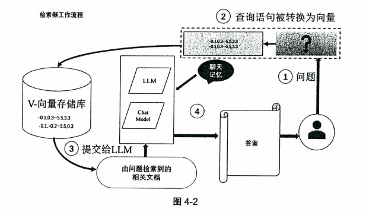

# 相关概念
目的：

检索与用户输人的问题相关的外部数据，包括筛选相关问题和相关的
文档。然后，这些相关数据会形成提示词模板，提交给LLM或ChatModel类型的模
型包装器。这些模型包装器封装了各个大语言模型平台的底层API，使得我们可以方
便地与这些平台进行交互，获取大语言模型平台的输出。

# LEDVR工作流
1. L代表加载器（Loader），
2. E代表嵌人模型包装器（TextEmbedding Model),
3. D代表文档转换器(Document Transformers),
4. V代表向量存储库(VectorStore),
5. R代表检索器（Retriever）。



加载器负责从各种来源加载数据作为文档，其中文档是由文本和相关元数据组成
的。无论是简单的.txt文件，还是任何网页文本内容，加载器都可以将它们加载为文
档。
```python
# 加载的是一篇博客文章。文档加载器读取该网址的内容，并将其转换为一份文档数据。
from langchain.document_loaders import WebBaseLoader
loader = WebBaseLoader("http://developers.minil.cn/wiki/luawh.html")
data = loader.load()
```

嵌人模型包装器是一个专为与各种文本嵌人模型（如OpenAI、Cohere、Hugging
Face等）交互而设计的类。它的作用与模型I/O模块的LLM模型包装器和聊天模型
包装器一样。
```python
# 加载的是一篇博客文章。文档加载器读取该网址的内容，并将其转换为一份文档数据。
from langchain.embeddings.openai import OpenAIEmbeddings
embedding = OpenAIEmbeddings (openai_api_key="填入你的 openAI 密钥")
```

文档转换器主要用来对文档进行切割、组合、过滤等各种转换。数据增强模块提
供了一系列内置的文档转换器。最常见的文档转换是切割文档，例如，将大型文档切
割为小片段文档。文本切割器（RecursiveCharacterTextSplitter）是最常见的文档转换
工具。文档转换器的目的是将加载的文档转换为可被嵌人模型包装器操作的文档数据
格式。
```python
# 创建一个 RecursiveCharacterTextSplitter实例作为切割工具，并指定每个片段的大小为500个字符。
# 使用这个切割工具按照每个片段500个字符将数据切割成多个片段。
from langchain.text_splitter import RecursiveCharacterTextSplitter
text_splitter = RecursiveCharacterTextSplitter(chunk_size-500,
chunk_overlap=0)
splits = text_splitter.split_documents(data)
```

向量存储库是用于存储和检索嵌人向量的工具，处理的数据是通过模型平台的文
本嵌人模型（TextEmbeddingModel）转换的向量数据，这是处理非结构化数据的一
种常见方法。向量存储库负责存储嵌人数据并执行向量检索。在检索时，可以嵌人非
结构化查询，以检索与嵌人数据“最相似”的嵌人向量。
```python
# 创建一个向量存储库：FAISS实例，用于存储这些向量数据。
from langchain.vectorstores import FAISS
vectordb = FAISS.from_documents(documents=splits, embedding-embedding)
```

检索器是一个接口，返回非结构化查询的文档。它比向量存储库更通用。检索器
无须存储文档，只需要返回（或检索）文档。
```python
# 最后，实例化一个检索器，在这些数据中进行检索。创建一个ChatOpenAI实例
# 和一个MultiQueryRetriever实例，用于执行检索问答。在这个例子中，
# 使用相似度查询方法get_relevant_documents，检索“LUA的宿主语言是什么？”。
from langchain.chat_models import ChatOpenAI
from langchain.retrievers.multi_query import MultiQueryRetriever
question="LUA的宿主语言是什么?"
llm = ChatOpenAI (openai_api_key="填人你的密钥")
retriever_from_llm = MultiQueryRetriever.from_llm(
retriever-vectordb.as_retriever(), llm=llm
)
docs = retriever_from_llm.get_relevant_documents (question)
```
## 数据类型
1. 文档数据;
2. 向量数据。

经过处理的文档数据会被传递给嵌人模型包装器，在这里，它们会被转换为向量
数据，完成文本向量化。文本向量化是将原始文本数据转换为向量的过程。向量是用
于机器学习模型处理的数值表示形式。这些向量数据会被存储在向量存储库中，在需
要时会对它们进行检索。检索过程由检索器完成，它根据用户的查询返回相应的数据。

# 加载器
1. csv
```python
loader = CsvLoader(file_path-'data.csv', encoding-'utf-8')
documents = loader.load()
```
2. 文件目录
```python
loader = DirectoryLoader(path-'data_directory')
documents = loader.load()
```
3. HTML
```python
from langchain.document_loaders import BSHTMLLoader
loader = BSHTMLLoader(file_path='example.html')
documents = loader.load()
```
4. JSON
```python
# JSON
# -> [("text": ...}, ("text": ...}, {"text": ...}]
# jq_schema
# ->".[].text"
# JSON
# -> {"key": [("text": ...}, ("text": ...}, ("text": ...}])
# jq_schema
# ->
# ".key[].text"
# JSON
# -> ["...","...","..."]
# jq_schema
# ->
# ".[]"

from langchain.document_loaders import JsoNLoader
loader = JsoNLoader(file_path='example.json', Jq_schema='.[]')
documents = loader.load()
```
5. Markdown
```python
markdown_path = "../../../../../README.md"
loader = UnstructuredMarkdownLoader (markdown_path, mode="elements")
documents = loader.load()
```
6. PDF

- PyPDF文档加载器：它可以将PDF文档加载为文档数组，数组中的每个文档包含页面内容和页码的元数据。示例如下：
```python
from langchain.document_loaders import MathpixPDFLoader
loader = MathpixPDFLoader ("example_data/layout-parser-paper.pdf")

# 为不同的文本块创建不同的元素
from langchain.document_loaders import UnstructuredPDFLoader
loader = UnstructuredPDFLoader("example_data/layout-parser-paper.pdf")
```
- 在线PDF文档加载器：它可以加载在线PDF文档，并将其转换为可以在下游
使用的文档格式，示例如下：
```python
from langchain.document_loaders import OnlinePDFLoader
loader=OnlinePDFLoader("请参考本书代码仓库URL映射表，找到对应资源://arxiv.org/pdf/2302.03803.pdf")
```
- PyPDFium2文档加载器：使用PyPDFium2文档加载器加载PDF文档的示例如下：
```python
from langchain.document_loaders import PyPDFium2Loader
loader = PyPDFium2Loader ("example_data/layout-parser-paper.pdf")
data = loader.load()
```
- PDFMiner文档加载器：使用PDFMiner文档加载器加载PDF文档的示例如下：
```python
from langchain.document_loaders import PDFMinerLoader
loader = PDFMinerLoader("example_data/layout-parser-paper.pdf")
```
- 使用PDFMiner文档加载器可生成HTML文档。这对于将文本按照语义划分
为各个部分非常有帮助，生成的HTML内容可以通过使用Python的BeautifulSoup库
进行解析和处理，以获取关于字体大小、页码、PDF文件头/页脚等更多结构化的信息。
- PyMuPDF文档加载器：这是最快的一种PDF文档加载器，它输出的文档包含
关于PDF及其页面的详细元数据，且为每页返回一个文档。
```python
from langchain.document_loaders import PyMuPDFLoader
```
- PyPDFDirectoryLoader文档加载器可从目录加载PDF文档，示例如下：
```python
from langchain.document_loaders import PyPDFDirectoryLoader
```
- PDFPlumberLoader文档加载器：与PyMuPDF文档加载器类似，其输出的文
档包含关于PDF及其页面的详细元数据，且为每页返回一个文档。
--- 

# 嵌入模式包装器

LangChain框架提供了一个名为Embeddings的类，它为多种文本嵌人模型（如
OpenAI、Cohere、HuggingFace等）提供了统一的接口。通过该类实例化的嵌人模型
包装器，可以将文档转换为向量数据，同时将搜索的问题也转换为向量数据，这使得
可通过计算搜索问题和文档在向量空间中的距离，来寻找在向量空间中最相似的文
本。
## 类型
1. 自然语言模型嵌人：这类嵌人包括OpenAIEmbeddings、HuggingFace
Embeddings、HuggingFaceHubEmbeddings、HuggingFaceInstructEmbeddings、 SelfHosted
HuggingFaceEmbeddings和 SelfHostedHuggingFaceInstructEmbeddings等。这类嵌人主
要利用诸如OpenAI、Hugging Face等自然语言处理模型进行文本嵌人。
2. AI平台或云服务嵌人：这类嵌人主要依托AI平台或云服务的能力进行文本嵌
入，这类嵌人主要包括Elasticsearch、SagemakerEndpoint和 DeepInfra等。这类嵌人
的主要特点是能够利用云计算的优势，处理大规模的文本数据。
3. 专门的嵌人模型：这类嵌人专门用于处理特定结构的文本，主要包括
AlephAlpha 的 AsymmetricSemanticEmbedding 和 SymmetricSemanticEmbedding 等,这
类嵌人适用于处理结构不同或相似的文本。
4. 自托管嵌人：这类嵌人一般适用于用户自行部署和管理的场景，如
SelfHostedEmbeddings，给予用户更大的灵活性和控制权。
5. 仿真或测试用嵌人：例如，FakeEmbeddings一般用于测试或模拟场景，不涉
及实际的嵌人计算。
6. 其他类型：此外，LangChain还支持一些其他类型的嵌人方式，如Cohere、
LlamaCpp、ModelScope、TensorflowHub、MosaicMLInstructor、MiniMax、Bedrock、
DashScope和Embaas等。这些嵌人方式各有特点，能够满足不同的文本处理需求。
## 文档转换器
目的：处理海量文档
两个步骤：
1. 对文档进行切割，主要由切割器完成；
2. 将切割后的文档转换为Document数据格式。
### 文本切割
工作原理是：将文本切割成小的、在语义上有意义的文本块（通常
是句子）。由这些小文本块开始，再组合成大的文本块，直到达到某个大小（通过某
种函数进行测量）。一旦达到该大小，就将该块作为一个文本片段。然后开始创建新
的文本块，新的文本块和前一个文本块会有一些重叠（以保持块与块之间的上下文）。

推荐的文本切割器是RecursiveCharacterTextSplitter。在默认情况下，它尝试切割的字符是["nn”，"n","",
""]。
- length_function：如何计算文本块的长度。默认只计算字符数量，但是通常
会给其传人一个标记计数器。
- chunk_size：文本块的最大大小（由长度函数测量）。
- chunk_overlap：文本块之间的最大重叠。有一些重叠可以在文本块之间保
持连续性（例如采用滑动窗口的方式）。
- add_startindex：是否在元数据中包含每个文本块在原始文档中的起始位置。

1. 按字符切割
这是最简单的切割方法。它基于字符（默认为”n\n”）进行切割，并通过字符数
量来测量文本块的大小。使用chunk_size属性可设置文本块的大小，使用
chunk_overlap属性设置文本块之间的最大重叠。
```python
# This is a long document we can split up.
with open('../../../state_of_the_union.txt') as f:
    state_of_the_union = f.read()
from langchain.text_splitter import CharacterTextSplitter
text_splitter = CharacterTextSplitter(
chunk_size = 1000,
chunk_overlap = 200,
)
texts = text_splitter.create_documents([state_of_the_union])
print(texts[0])
```
2. 代码切割
language : 'cpp'、'go'、'java'、
js'、'php'、'proto'、'python'、'rst'、'ruby'、'rust'、'scala'、'swift'、'markdown'、'latex'、"html'、
'so'等多种编程语言。
```python
from langchain.text_splitter import (
RecursiveCharacterTextSplitter,
Language,
)
JS_CODE = """
function helloworld() (
    console.log("Hello, World!");
)

// Call the function
helloworld():
"""
js_splitter = RecursiveCharacterTextSplitter.from_language(
language=Language.JS, chunk_size=60, chunk_overlap=0
)
js_docs = js_splitter.create_documents ([JS_CODE])
js_docs
```
3. Markdown标题文本切割器
```python
# Char-level splits
from langchain.text_splitter import RecursiveCharacterTextSplitter
chunk_size = 250
chunk_overlap = 30
md_header_splits = RecursiveCharacterTextSplitter(
    chunk_size-chunk_size, chunk_overlap-chunk_overlap
)
# Split
splits = text_splitter.split_documents(md_header_splits)
```
4. 按字符递归切割
换行符、空格、"\n\n", "\n"," ","
5. 按标记(Token)切割
- Tiktoken标记切割器：它是由OpenAI创建的一种快速的字节对编码(BPE)
标记器。可以使用它来估计使用的标记数量。对于OpenAI的模型来说，
它的准确度是比较高的。该切割器的文本切割方式是按照传人的字符进行
切割，文本块大小也由它计算。该标记切割器的使用方式有些复杂，下面
通过代码展示它的使用方式。首先要安装tiktokenpython包。然后导人
CharacterTextSplitter类，再使用类方法from_tiktoken_encoder实例化这个
类。与SpacyTextSplitter等其他内置的切割器不一样的是，Tiktoken标记切
割器是由CharacterTextSplitter类的类方法实例化而来的。
```python
# pip install tiktoken
# This is a long document we can split up.
with open("../../../state_of_the_union.txt") as f:
    state_of_the_union = f.read()
from langchain.text_splitter import CharacterTextSplitter
text_splitter = CharacterTextSplitter.from_tiktoken_encoder(
    chunk_size=100, chunk_overlap=0
)
texts = text_splitter.split_text (state_of_the_union)
```

- SpaCyTextSplitter标记切割器：SpaCy是一种用于高级自然语言处理的开
源软件库，是用Python和Cython编写的。SpaCyTextSplitter标记切割器的
文本切割方式是通过SpaCy标记器进行切割，文本块大小通过字符数量计
算。它是NLTKTextSplitter标记切割器的替代方案。
- SentenceTransformersTokenTextSplitter标记切割器：它是专门用于处理句子
转换模型的专用文本切割器。该切割器的默认行为是将文本切割成适合所
要使用的句子转换器模型的标记窗口的文本块。
- NLTKTextSplitter标记切割器：NLTK（Natural Language Toolkit）是一套支
持符号方法和统计方法的自然语言处理Python库。与仅仅在"nn"处切割
不同，NLTKTextSplitter标记切割器的文本切割方式是通过NLTK标记器
进行切割，文本块大小通过字符数量进行计算。
- HuggingFace标记切割器：它提供了许多标记器。可使用HuggingFace标
记切割器的标记器GPT2TokenizerFast来计算文本长度（以标记为单位）。
该切割器的文本切割方式是按照传人的字符进行切割。文本块大小的计算
方式是，使用HuggingFace标记器计算出标记数量。这个标记切割器的使
用方式更复杂一些，下面通过代码展示它的使用方式。

# 向量数据库
两个核心方法： embed_documents和embed_query

向量存储库可以被看作一个大的包装器，它负责处理数据增强模块中LEDVR工
作流的LED环节的输出结果。对于开发者来说，使用向量存储库可以极大地简化工
作。开发者不需要关心如何与各个模型平台进行交互，也不需要将数据处理成其他形
式。比如，LEDVR工作流一直都在处理Document对象格式的数据，开发者只需要专
注于这个格式，然后将数据交给向量存储库就可以了。向量存储库会在底层处理数据
格式的转换、解析模型包装器的返回数据等各种复杂的工作。

## 使用
```python
from langchain.document_loaders import TextLoader
from langchain.embeddings.openai import OpenAIEmbeddings
from langchain.text_splitter import CharacterTextSplitter
from langchain.vectorstores import FAISS
#LEDVR: raw_documents是L, OpenAIEmbeddings ()是 E, documents是 D, db 是v
raw_documents = TextLoader('../../../state_of_the_union.txt').load()
text_splitter = CharacterTextSplitter(chunk_size=1000, chunk_overlap=0)
documents = text_splitter.split_documents (raw_documents)
db = FAISS.from_documents (documents, OpenAIEmbeddings ())

query = "What did the president say about Ketanji Brown Jackson"
docs = db.similarity_search(query)
print (docs[0].page_content)
```
## 搜索方法
1. similarity_search(query: str, k: int = 4) ->List[Document]。这个方法接受一个字符
串查询和一个整数k作为参数，返回与查询最相似的k个文档的列表。query是要搜
索的字符串，k是要返回的文档数量，默认为4。
2. similarity_search_by_vector(embedding:List[float], k: int =4)->List[Document]。
这个方法接受一个嵌人向量和一个整数k作为参数，返回与嵌人向量最相似的k个文
档的列表。嵌人向量是由文本嵌人模型生成的查询的向量表示。
3. max_marginal_relevance_search(query: str,k: int = 4,fetch_k: int = 20,lambda
mult:float =0.5)->List[Document]。这个方法使用最大边际相关性算法返回选择的文
档。最大边际相关性算法优化了查询的相似性和所选择文档之间的多样性。query是
要搜索的字符串，k是要返回的文档数量，默认为4。fetch_k是要传递给最大边际相
关性算法的文档数量。lambda_mult是一个0~1之间的数字，它决定了结果之间的多
样性程度，0对应最大的多样性，1对应最小的多样性，默认为0.5。
4. max_marginal_relevance_search_by_vector(embedding: List[float], k: int = 4,
fetch_k: int = 20,lambda_mult: float = 0.5) ->List[Document]。这个方法与上面的
max_marginal_relevance_search方法类似，但是接受的是嵌人向量而不是查询字符串
作为输人。
# 检索器
向量存储库种类繁多，比如Chroma、FAISS、Pinecone、Zilliz等。
LangChain封装了VectorStoreRetriever类，提供了一个标准
接口。开发者可以通过在向量存储库的实例上调用as_retriever方法得到一个基于向量
存储库的检索器，即VectorStoreRetriever类的实例。

我们从原理上来理解检索器，那就是从向量存储库到检索器，中间只需一个
as_retriever方法。向量存储库调用它，便创建了一个检索器。这就组成了LEDVR工
作流，as_retriever方法粘合了V和R，整个LEDVR工作流到此结束。

在处理用户查询时（如图4-2第①步），首先需要通过检索器获取相关的文档（如
图4-2第③步），这些文档能够帮助回答用户的问题。然后，需要将这些文档提交给
模型平台，依靠大语言模型的能力生成回答（如图4-2第④步）。

比如，当在LangChain中配置好模型包装器和检索器之后，链组件首先会利用检
索器把用户的问题转换为向量（如图4-2第②步），在向量存储库中找到相关的文档，
然后将这些文档送人模型包装器，最后返回模型生成的答案。在这个过程中，只需要
关心如何配置模型包装器和检索器，而不需要关心这些基础模块之间的交互细节，因
为所有这些工作都由链组件自动完成了。

## 使用
下面使用代码示例来展示如何在LangChain中配置模型包装器和检索器，然后使
用链组件来实现信息检索并返回问题答案。首先，使用TextLoader加载文本文件
"state_of_the_union.txt"，该文件包含了一系列的文档：
```python
loader = TextLoader("../../state_of_the_union.txt")
documents = loader.load()
```
加载文件后，使用CharacterTextSplitter对文档进行切割，将每篇文档都切割成
一系列的文本块。每个文本块的大小为1000个字符，相邻的文本块之间有重叠部分：
```python
text_splitter = CharacterTextSplitter(chunk_size=looo, chunk_overlap=0)
texts - text_splitter.split_documents(documents)
```
然后，使用OpenAIEmbeddings为文本块生成嵌人向量，并使用Chroma将这
些文本块和对应的嵌人向量存储起来。此过程创建了一个向量存储库的实例
```python
docsearch:
embeddings = OpenAIEmbeddings()
docsearch = Chroma.from_documents(texts, embeddings)
```
最后，使用RetrievalQA创建一个检索式问答系统。这个系统使用了之前创建的
docsearch作为检索器，将OpenAI大语言模型作为回答生成器。这个系统可以根据用
户的问题，找到相关的文本块，然后生成回答：
```python
qa = RetrievalQA.from_chain_type(llm-OpenAI(),
chain_type="stuff", retriever-docsearch.as_retriever()
```
在这个过程中，只需要关心如何配置模型包装器和检索器，而不需要关心这些组
件之间的交互细节，因为链组件已经帮我们自动处理了所有的事情。
## 类型
1. 自查询检索器。这种检索器适用于需要通过自然语言查询来检索具有一定结构
或元数据的文档的场景。比如，在一个电子商务网站中，用户可能会输人“最新的
iPhone手机”，自查询检索器则可以将这个查询转换为一个结构化的查询，比如：
("category": "手机", "brand": "iPhone","order":"newest")，从而更精确地获取用户想要
的结果。
2. 时间加权向量存储检索器。这种检索器适用于信息的新旧程度对查询结果影响
较大的场景。比如，在新闻检索中，用户通常更关心最新的新闻，因此检索器需要根
据新闻的发布时间来对结果进行排序。
3. 向量存储支持的检索器。这种检索器适用于需要基于语义相似度进行查询的场
景。比如，在问答系统中，用户的问题可能会有很多种表达方式，只有理解了问题的
语义，才能找到正确的答案。
4. 网络研究检索器。这种检索器适用于需要从网络上获取最新数据的场景。比如，
用户可能想要获取关于一个热点事件的最新信息，此时检索器可以直接从网络上进行
检索，以便获取到最新的信息。