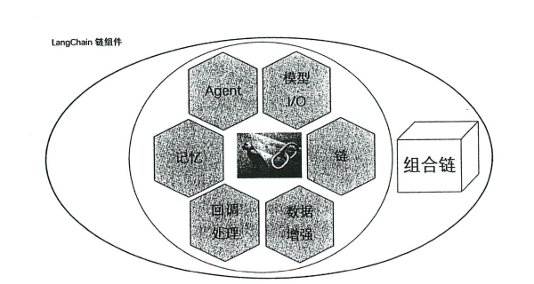
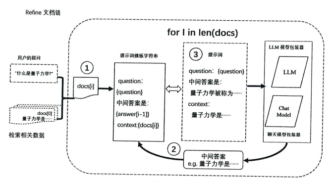
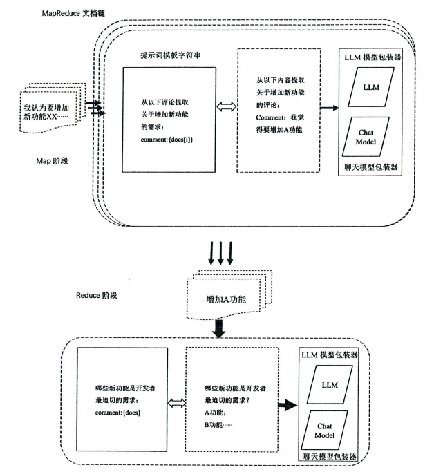
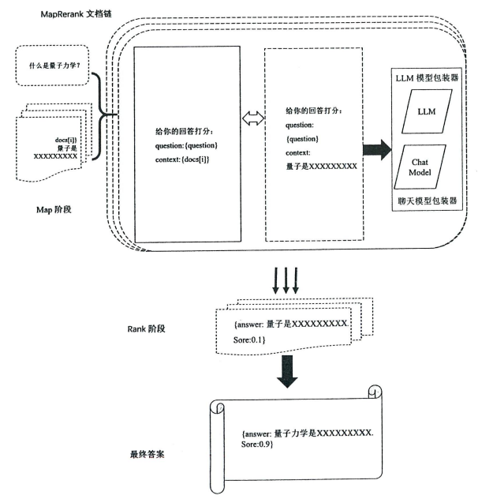
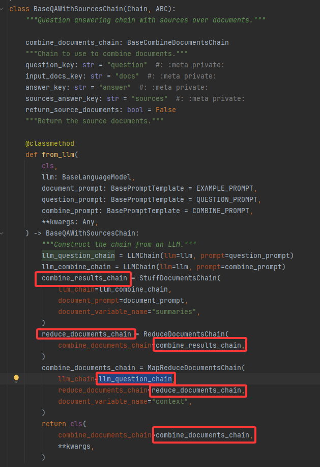

# 为什么叫链
每一个链都是由一系列组件构成的（如
图5-1所示），这些链组件可以是大语言模型、数据查询模块或者文档处理链，它们
都是为了解决某一特定问题而设计的。这样的设计，使得我们可以灵活地组合使用各
种链组件，形成一个完整的数据处理流程，从而解决更复杂的问题。比如常见的模型链、会话链、QA链等都是链组件。


# 定义
链是连接组件、管理组件数据流的“包装器”。

工作流程：从输人数据的接收，到数据的处
理，再到最终的大语言模型预测。整个流程是通过使用链模块将各个链组件连接在一
起形成的。

# 使用
Chain是一个Python类，表示一种操作流程。这是一种可以接受一些输人，并通
过特定的逻辑处理这些输人，然后产生一些输出的对象。本节我们分三步来介绍链的
使用。
1. 准备输入
首先，需要准备一些输人，输人是一个字典，其键是由prompt对象的
input_variables属性决定的。我们需要根据实际的prompt对象来确定需要哪些输入。
2. 实例化链类
接着，需要实例化Chain类。需要提供一个BasePromptTemplate对象和一个
BaseLanguageModel 对象。
3. 运行链
使用函数式调用是最方便的方法，传递参数来运行链。还可以使用runO、arun)
或applyO方法来运行链。这些方法都接受输人并提供一些可选的参数：
- inputs：字典类型，包含了需要的输人变量。
- return_only_outputs（可选）：布尔值，表示是否只返回输出。如果为True,
则只返回由这个链生成的新键。如果为False，则返回输人键和由这个链生
成的新键。默认为False。
- callbacks（可选）：用于设置Chain运行时需要调用的回调函数集合。
- include_run_info（可选）：布尔值，表示是否在响应中包含运行信息。默
认为 False。

run()和arun()方法都是直接运行链并获取字符串的方法。这两个方法的区别在
于，后者支持异步调用。

apply()方法是一个可以由子类自定义的方法。例如，在LLMChain中，applyO
方法接受一个字典列表作为输人，每个字典都包含一组输人。
这是使用链的基本步骤。根据具体的Chain类和你的需求，可以适当调整这些步
骤。

## 异步支持
LangChain通过使用asyncio库为链提供异步支持。
目前LLMChain（通过使用arun、apredict和 acall方法）、LLMMathChain（通过
使用arun和acall方法）、ChatVectorDBChain及QA链支持异步操作。其他链的异步
支持正在规划中。

## 使用方法解析
所有的链都可以像函数一样被调用。当链对象只有一个输出键（也就是说，它的
output_keys中只有一个元素）时，预期的结果是一个字符串，此时可以使用run方法。
在LangChain中，所有继承自Chain类的对象，都提供了一些用于执行链逻辑的
方式，其中一种比较直接的方式就是使用_call_方法。_call_方法是Chain类的
一个方法，它让Chain类的实例可以像函数一样被调用，比如result=chain(inputs,
return_only_outputs=True)就完成了链调用。
_call_方法的定义如下：
```python
def _call_(
    self,
    inputs: Union[Dict[str, Any], Any],
    return_only_outputs: bool = False,
    callbacks: Callbacks = None,
    *,
    tags: Optional[List[str]] = None,
    include_run_info: bool = False,
)-> Dict[str, Any]:
```
_call_方法的参数中最有用的是以下3个：
- inputs：这个参数的值是要传递给链的输人，它的类型是Any，这意味着
它可以接受任何类型的输人。
- return_only_outputs：这个参数是一个布尔值，如果设为True，则方法只返
回输出结果。如果设为False，则可能返回其他额外的信息。
- callbacks：这个参数的值是回调函数的列表，它们将在链执行过程中的某
些时刻被调用。
- 
_call_方法返回一个字典，这个字典包含了链执行的结果和可能的其他信息。
在Python中，如果一个类定义了_call_方法，那么这个类的实例就可以像函
数一样被调用。例如，如果chain是Chain类的一个实例，那么你可以像调用函数一
样调用chain:
```python
result = chain(inputs, return_only_outputs=True)
```

在这个调用中，inputs是要传递给链的输人，return_only_outputs=True表示只返
回输出结果。返回的result是一个字典，包含了链执行的结果。

最重要的参数是inputs，如以下示例:
```python
chat = ChatOpenAI (temperature=0)
prompt_template - "Tell me a (adjective) joke"
llm_chain = LLMChain(llm-chat,
prompt=PromptTemplate.from_template (prompt_template))
llm_chain(inputs=("adjective": "corny"))
```

以上代码返回的结果是：
```shell
('adjective': 'corny',
'text': "Why did the tomato turn red? Because it saw the salad dressing!')
```
可以通过设置return_only_outputs为True来配置方法只返回输出键值。
```python
llm_chain("corny", return_only_outputs=True)
```

下面返回的结果就不包含"adjective":"corny":
```shell
('text': 'Why did the tomato turn red? Because it saw the salad dressing!')
```
然而，当链对象只有一个输出键（也就是说，它的output_keys中只有一个元素）
时，则可以使用run方法运行链。
```python
# llm_chain only has one output key, so we can use run
llm_chain.output_keys['text']
```
output_keys中只有一个元素['text]，可以使用run方法：
```python
llm_chain.run(("adjective": "corny")
```
如果输人的键值只有一个，则预期的输出也是一个字符串，那么输人可以是字符
串也可以是对象，在这种情况下可以使用run方法也可以使用_call_方法运行链。

run方法将整个链的输人键值（input key values)进行处理，并返回处理后的结果。
需要注意的是，与_call_方法可能返回字典形式的结果不同，run方法总是返回一个
字符串。这也是为什么当链对象只有一个输出键时，倾向于使用run方法，因为这时
候处理结果只有一个，返回字符串更直观也更便于处理。

例如，假设有一个链对象，它的任务是根据输人的文本生成摘要，那么在调用run
方法时，可以直接将待摘要的文本作为参数输人，然后得到摘要文本。在这种情况下，
可以直接输人字符串，而无须指定输人映射。

另外，可以很容易地将一个Chain对象作为一个工具，通过它的run方法集成到
Agent中，这样可以将链的处理能力直接应用于Agent逻辑中。

## 基础类型
1. LLM链是一种简单的链。它在LangChain中被广泛应用，包括在其他链和代
理中。LLM链由提示词模板和模型包装器（可以是LLM或ChatModel模型包装器）
组成。它使用提供的输人键值格式化提示词模板，然后将格式化的字符串传递给LLM
模型包装器，并返回LLM模型包装器的输出。上一节中的示例代码便使用了LLM链。
2. 路由器链是一种使用路由器创建的链，它可以动态地选择给定输人的下一条
链。路由器链由两部分组成：路由器链本身（负责选择要调用的下一条链）和目标链
（路由器链可以路由到的链）。
3. 顺序链在调用语言模型后的下一步使用，它特别适合将一次调用的输出作为另
一次调用的输人的场景。顺序链允许我们连接多个链并将它们组成在特定场景下执行
的流水线。顺序链有两种类型：SimpleSequentialChain（最简单形式的顺序链，其中
每一步都有一个单一的输人/输出，一个步骤的输出是下一个步骤的输人）和
SequentialChain（一种更通用的顺序链，允许多个输人/输出）。
4. 转换链是一个用于数据转换的链，开发者可以自定义transform函数来执行任
何数据转换逻辑。这个函数接受一个字典（其键由input_variables指定）作为参数并
返回另一个字典（其键由output_variables指定）。

## 工具链
### 常见工具链
1. APIChain使得大语言模型可以与API进行交互，以获取相关的信息。构建该链
时，需要提供一个与指定API文档相关的问题。
2. ConversationalRetrievalQA链在问答链的基础上提供了一个聊天历史组件。它首
先将聊天历史（要么明确传人，要么从提供的内存中检索）和问题合并成一个独立的
问题，然后从检索器中查找相关的文档，最后将这些文档和问题传递给一个问答链，
用以返回响应。
3. 对于需要将多个文档进行合并的任务，可以使用文档合并链，如
MapReduceDocumentsChain或 StuffDocumentsChain等。
4. 对于需要从同一段落中提取多个实体及其属性的任务，则可以使用提取链。
5. 还有一些专门设计用来满足特定需求的链，如ConstitutionalChain，这是一个保证
大语言模型输出遵循一定原则的链，通过设定特定的原则和指导方针，使得大语言模
型生成的内容符合这些原则，从而提供更受控、符合伦理和上下文的回应内容。
#### 工具链的使用方法
from_llmO和from_chain_typeO，它们都接受外部的数据来源作为参数
```python
from langchain import OpenAI, SQLDatabase, SQLDatabaseChain
db = SQLDatabase.from_uri("sqlite:///../../../../notebooks/Chinook.db")
llm = OpenAI (temperature=0, verbose=True)
db_chain = SQLDatabaseChain.from_llm(llm, db, verbose=True)
db_chain.run("How many employees are there?")
```

运行的结果是：
```shell
> Entering new SQLDatabaseChain chain...
How many employees are there?
SQLQuery:
/workspace/LangChain/LangChain/sql_database.py:191: SAWarning: Dialect
sqlite+pysqlite does *not* support Decimal objects natively, and sQLAlchemy must
convert from floating point - rounding errors and other issues may occur. Please
consider storing Decimal numbers as strings or integers on this platform for
lossless storage.
sample_rows = connection.execute(command)
SELECT COUNT(*) FROM "Employee";
SQLResult: [(8,)]
Answer:There are 8.employees.
> Finished chain.
'There are 8 employees.'
```
## 基础链
基础链是整个运行链的基础。最常使用的基础链：LLM链、路 由器链和顺序链。

### LLM链 : LLMChain
LLM链是一个非常简单的链组件。这是我们最常见到的链组件。它的作用只是
将一个大语言模型包装器与提示词模板连接在一起。使用提示词模板来接收用户输
人，并使用模型包装器发出聊天机器人的响应。

### 路由器链 : LLMRouterChain
路由器链是一种编程范式，用于动态选择下一个要使用的链来处理给定的输人。
在LangChain中，路由器链主要由两部分构成：一是路由器链自身，它的任务是负责
选择下一个要调用的链；二是所有目标链的字典集合。
负责根据某种逻辑或算法来选
择下一个要调用的链。路由器链是利用提示词指导模型的能力，让模型按照某种评估
或匹配机制选择下一个链。路由器链使用LLM模型包装器来决定如何路由，如下例
所示：
```python
from langchain.chains.router.llm_router import LLMRouterChain

# 创建 LIMRouterChain
router_chain = LLMRouterChain.from_llm(llm, router_prompt)

destination_chains = {}
for p_info in prompt_infos:
    name = p_info["name"]
    prompt_template = p_info["prompt_template"]
    prompt =
        PromptTemplate (template-prompt_template,input_variables=["input"])
    chain = LLMChain(llm=llm, prompt-prompt)
    destination_chains[name] = chain
```
destination_chains是一个字典，其中的键通常是目标链的名称或标识符，值则是
这些目标链的实例。

值得注意的是，因为destination_chains是一个字典结构，所以可以在运行时动态
地添加或删除目标链，而无须修改代码。

### 顺序链 : SimpleSequentialChain
顺序链是多个链组件的组合，并且按照某种预期的顺序执行其中的链组件。

下面使用简单的顺序链（SimpleSequentialChain）来完成提炼10个文章事实和写
摘要的两个任务。简单的顺序链就像PyTorch中的标准顺序模型一样，它只是从A到
B到C，没有做任何复杂的操作。顺序链的便利性在于，它接收包含多个链组件的数
组，并合并多个链组件。比如提炼10个文章事实和写摘要的两个任务链，使用顺序
链将它们合并之后，运行得到的响应是两个任务的答案。本来需要运行两次链组件，
而使用顺序链后只需运行一次。

```python
from langchain.chains import SimpleSequentialChain, SequentialChain
full_chain = SimpleSequentialChain(
    chains=[fact_extraction_chain, investor_update_chain],
    verbose=True
)
response = full_chain.run(article)
```
通过使用顺序链，成功地将原本需要手动执行的两步操作简化为了一步。在这个
顺序链组件内部，数据的流动和管理都被自动处理了，开发者并不需要关心这些细节。

### 四大合并文档链
1. Stuff链是处理方式最直接的一个文档链。它接收一组文档，将它们全部插人
一个提示中，然后将该提示传递给LLM链。这种链适合于文档较小且大部分调用只
传人少量文档的应用程序。
2. Refine链通过遍历输人文档并迭代更新其答案来构建响应。对于每个文档，它
将所有非文档输人、当前文档和最新的中间答案传递给LLM链，以获得新的答案。
由于Refine链一次只向LLM链传递一个文档，因此它非常适合需要分析模型上下文
容纳不下的文档的任务。但显然，这种链会比Stuff这样的链调用更多的LLM链。此
外，还有一些任务很难通过迭代来完成。例如，当文档经常相互交叉引用或任务需要
许多文档的详细信息时，Refine链的表现可能较差。
3. MapReduce链首先将LLM链单独应用于每个文档（Map步骤），并将链输出
视为新的文档。然后，它将所有新文档传递给一个单独的文档链，以获得单一的输出
（Reduce步骤）。如果需要，这个压缩步骤将递归地执行。
4. 重排链（MapRerank）与MapReduce链一样，对每个文档运行一个初始提示
的指令微调。这个初始提示不仅试图完成一个特定任务（比如回答一个问题或执行一
个动作），也为其答案提供了一个置信度得分。然后，这个得分被用来重新排序所有
的文档或条目。最终，得分最高的响应被返回。这种机制有助于在多个可能的答案或
解决方案中，找到最合适、最准确或最相关的一个。重排链通过添加一个重排序或重
打分步骤，进一步提高系统的性能和准确性。
#### Refine链
Refine文档链通过遍历输人文档并迭代更新其答案来构建响应。对于每个文档，
它将所有非文档输人（例如用户的问题或其他与当前文档相关的信息）、当前文档和
最新的中间答案传递给LLM链，以获得新的答案。包含中间答案的提示词是这个类
型文档链的重要特征，如图所示。

在遍历文档阶段（图的for i in len(docs)），系统会遍历输人的所有文档。
对于每个文档，一起作为提示词被传递给模型包装器的内容有：一些上下文信息，例
如用户的问题，或者其他与当前文档相关的信息。

最新的中间答案。中间答案是系统在处理之前的文档时产生的。一开始，中间答
案可能是空的，但随着系统处理更多的文档，中间答案会不断更新。

Refine链与MapReduce链和重排链不同的是，它不产生新文档，只是不断更新
提示词模板，迭代出更全面的答案。而且文档之间的影响是传递性的，由上一个文档
形成的答案会影响从下一个文档得到的答案。

在更新答案阶段，系统将提示传递给LLM链，然后将LLM链生成的答案作为新
的中间答案。这个过程会迭代进行，直到所有的文档都被处理。

Refine链最终实现的效果是，系统可以对包含多个文档的问题生成一个全面的答
案，而且对每个文档的处理结果都会影响对后续文档的处理。这种处理方式可以提高
文档搜索的质量，特别是在处理大量文档的情况下。

Refine链适用于处理大量文档，特别是当这些文档不能全部放人模型的上下文中
时。然而，这种处理方式可能会使用更多的计算资源，并且在处理某些复杂任务（如
文档之间频繁地交叉引用，或者需要从许多文档中获取详细信息）时可能表现不佳。

#### MapReduce 链
MapReduce链的整体流程主要由两部分组成：映射阶段（图Map阶段）和归
约阶段（图Reduce阶段）。在映射阶段，系统对每个文档单独应用一个LLM链
（图的LLM模型包装器），并将链输出视为新的文档。在归约阶段，系统将所有
新文档传递给一个单独的文档链，以获得单一的输出。如果需要，系统会首先压缩或
合并映射的文档，以确保它们适合相应的文档链。

在映射阶段，系统使用LLM链，对每个输人的文档进行处理。处理的方式是，
将当前文档作为输人传递给LLM链，然后将LLM链的输出视为新的文档。这样，每
个文档都会被转换为一个新的文档（图中间虚线框代表多个新文档），这个新文
档包含了对原始文档的处理结果。新文档是MapReduce链的主要特征。

对于每个文档，作为提示词模板的一部分传递给LLM链的内容是原始文档。
MapReduce链比起Stuff链多了预处理步骤，也就是说对每个文档的处理都产生了一
个新的文档，这个新文档是运行LLM链的结果。

每个原始文档都经过LLM链处理，处理结果被写人一个新文档，这就是映射的
过程。比如原文档有2000字，经过LLM链处理后，结果是200字。将这200字的结
果存储为一个新文档，但是新文档与2000字原文档存在着映射关系。

在归约阶段，系统使用合并文档链将映射阶段得到的所有新文档合并成一个文
档。如果新文档的总长度超过了合并文档链的容量，那么系统会运行一个压缩过程将
新文档的数量减少到合适的数量。这个压缩过程会递归运行，直到新文档的总长度满
足要求。

MapReduce链最终实现的效果是，系统可以对每个文档单独进行处理，然后将所
有文档的处理结果合并在一起。这种处理方式可以提高文档搜索的质量，特别是在处
理大量文档的情况下。

MapReduce链适用的场景是需要处理大量文档时，特别是当这些文档不能全部放
人模型的上下文中时。通过并行处理每个文档并合并处理结果，这种处理方式可以在
有限的资源下处理大量的文档。然而，由于每个文档都需要跟LLM链交互，产生新
的文档，因此这样的处理方式会使用大量的API调用，不适合大量交叉引用文档的情
况，或者需要从大量文档中获取详细信息的情况（由于该链有递归压缩的步骤）。

#### 重排链
重排链的整体流程是，对每个文档运行一个初始提示的指令微调，这个提示不仅
试图完成任务，还对其答案的确定程度给出评分。最后，得分最高的响应将被返回，
如图所示。


在映射（图 Map阶段）和评分阶段（图Map阶段的提示词模板“给你的
回答打分”），系统对每个文档运行一个初始提示的指令微调。每个文档都会被独立
地处理。处理的方式是，系统不仅试图完成任务，还对其答案的确定程度给出评分。
这样，每个文档都会被转换为一个新的文档，这个新文档包含了原始文档的处理结果
和评分。

对于每个文档，作为提示词的一部分传递给LLM链的内容是原始文档，但是提
示词模板增加了评分规则。得到LLM链给出的答案后，将其存储为一个新文档，而
且新文档与原文档有映射关系。

在重排阶段，系统根据每个新文档的评分进行重排（图Rank阶段）。重排的
意思是，之前在Map阶段文档已经被打分排序过，到这一步再给文档打分排序一次，
而且是重复排序。具体来说，系统最终会选择得分最高的新文档（图最终答案），
并将其作为最终的输出。只有这个类型的文档链有自动重排的机制，因为只有这个类
型的文档链，在对原始文档进行处理时，添加了评分规则的提示。

重排链最终实现的效果是，系统可以对每个文档独立地进行处理和评分，然后选
择得分最高的文档作为最终输出。这种处理方式可以提高文档搜索的质量，特别是在
处理大量文档的情况下。

重排链的适用场景是在处理大量文档时，特别是当需要从多个可能的答案中选择
最优答案时。通过对每个文档的处理结果进行评分和重排，这种处理方式可以在有限
的资源下找到最优的答案。然而，这种处理方式可能会使用更多的计算资源，并且可
能在处理某些复杂任务（如文档之间频繁地交叉引用，或者需要从许多文档中获取详
细信息）时表现不佳。

# 链的复杂性

### 链式套娃设计

