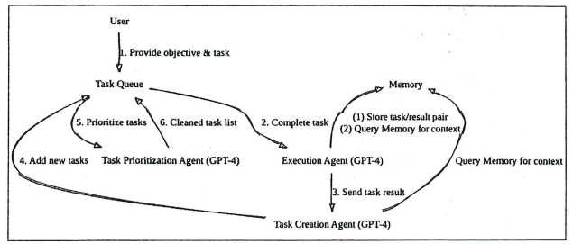

LangChain框架中的Agent模块是什么？为什么要使用Agent组件?


# 定义
Agent组件的核心是用大语言模型作为推理引擎，并根据这些推理来决定如何与
外部工具交互及采取何种行动。在LangChain
框架的Agent模块下，Agent组件是围绕几个核心组件（如不同类型的内置Agent组
件、Tools组件、Toolkits组件和AgentExecutor组件）进行构建的。

Agent组件的设计主要依赖于大语言模型的推理能力。因此，Agent组件的效能和状态很大程度上都
依赖于使用的提示词策略。

## ReAct是Agent 组件的实现方式
目前，LangChain框架中通用的一种Agent组件实现方式是ReAct组件，这是
“Reasoning andActing（推理与行动）”的缩写。这一策略最初由普林斯顿大学在他们
的论文中提出，并已被广泛应用于Agent组件的实现。

Agent组件的核心思想是利用大语言模型作为推理引擎。ReAct策略
组件则是将推理和行动融合在一起。Agent组件在接收用户的请求后，使用大语言模
型来选择合适的工具组件。然后，Agent组件执行选定的工具组件的操作，并观察结
果。这些结果会再次被反馈给大语言模型进行进一步的分析和决策。这个过程将持续
进行，直到达到某个停止条件。

## 运行机制
包括了很多功能：
1. 继承自Chain：AgentExecutor是Chain的子类，这意味着它继承了Chain类
的所有方法和属性，并且还可能添加或覆写一些特定的行为。
2. 成员变量agent：AgentExecutor类有一个名为agent的成员变量，这个变量
可以是BaseSingleActionAgent 或BaseMultiActionAgent 的实例。这个agent负责生成
计划或者动作。
3. agent的调用：take_next_step是AgentExecutor类的核心方法，负责每一步的
执行，在take_next_step方法内部agent的plan方法被调用，工具被找到并执行。
4. 工具（Tools）验证和管理：AgentExecutor负责验证提供给agent的工具是否
兼容，以及管理agent的执行，包括最大选代次数和最大执行时间。每一个agent动作
对应一个工具，这些工具在name_to_tool_map字典中进行查找和执行。

**AgentExecutor 实现了 Agent 的“决策”与“执行”的分离**。
1. **角色定位**  
   - **Agent**：只负责“计划”（决定下一步做什么）。  
   - **AgentExecutor**：负责“执行”（调用工具、处理异常、记录日志、管理流程）。  

2. **工作流程**  
   - AgentExecutor 先调用 Agent 的 `plan` 方法，获得一个 `AgentAction` 对象（包含要用的工具和输入）。  
   - AgentExecutor 执行该行动（调用相应工具）。  
   - 记录行动与结果，用于后续决策和日志追踪。

3. **类比项目经理**  
   - AgentExecutor 如同项目经理：分配任务、管理资源、跟踪进度、处理异常（如工具报错、解析失败）。

4. **使用方式**  
   - 先实例化 Agent，再将其传给 AgentExecutor。  
   - 通过调用 `AgentExecutor.run()` 启动流程。

5. **优点**  
   - 代码更易管理、扩展。  
   - 执行过程可控、可观测。

## 示例
```python
import os

# 设置API密钥
os.environ["OPENAI_API_KEY"] = "填入你的密钥"
os.environ["SERPAPI_API_KEY"] = "填入你的谷歌搜索的API密钥"

from langchain.agents import load_tools
from langchain.agents import initialize_agent
from langchain.agents import AgentType
from langchain.llms import OpenAI

# 初始化大语言模型
llm = OpenAI(temperature=0)

# 加载工具（谷歌搜索 + 数学计算）
tools = load_tools(["serpapi", "llm-math"], llm=llm)

# 初始化Agent组件
agent = initialize_agent(
    tools, 
    llm, 
    agent=AgentType.ZERO_SHOT_REACT_DESCRIPTION,
    verbose=True
)

# 运行Agent
agent.run("who is Leo DiCaprio's girlfriend? what is her current age raised to the 0.43 power?")
```
看一看AgentExecutor链组件运行的结果，重点是观察Observation、Action、
Answer及Thought的变化。这就是Agent在回答雷纳尔多（LeoDiCaprio）所经历的
中间步骤。这个中间步骤执行的便是ReAct框架的策略。
```commandline
Entering new AgentExecutor chain I need to find out who Leo DiCaprio's
girlfriend is and then calculate her age raised to the 0.43 power.
Action: Search Action Input: "Leo DiCaprio girlfriend"
Observation: Camila Morrone Thought: I need to find out Camila Morrone's age
Action: Search Action Input: "Camila Morrone age" Observation: 25 years
Thought: I need to calculate 25 raised to the 0.43 power Action: Calculator
Action Input: 25*0.43
Observation:
Answer:3.991298452658078
Thought: I now know the final answer Final
Answer: Camila Morrone is Leo DiCaprio's girlfriend and her current age raised
to the 0.43 power is 3.991298452658078．
Finished chain.
"Camila Morrone is Leo DiCaprio's girlfriend and her current age raised to
the 0.43 power is 3.991298452658078.″
```
## 类型
1. Zero-shot ReAct 组件（zero-shot-react-description)：该Agent 组件采用ReAct
框架组件，并仅根据工具组件的描述来选择工具组件。
2. 结构化输入反应组件（structured-chat-zero-shot-react-description)：该Agent
组件可以处理多输人工具组件。它可以使用工具组件的参数模式来创建结构化的行动
输人，非常适用于复杂的工具组件应用，如精确导航。
3. OpenAI函数组件（openai-functions）：该Agent 组件与特定的OpenAI模型
（如GPT-3.5-Turbo-0613和GPT-4-0613）共同工作，以便检测何时应调用函数组件。
4. 对话ReAct组件（conversational-react-description)：该Agent组件专为对话
环境设计。它使用ReAct框架组件来选择工具组件，并能记住之前的对话交互。
5. 自问与搜索组件（self-ask-with-search）：该Agent组件使用名为“Intermediate
Answer”的工具组件来寻找问题的事实答案。
6. ReAct文档存储组件（react-docstore）：该Agent 组件使用ReAct框架组件
与文档存储交互，它需要两个具体的工具组件：一个是搜索工具组件，另一个是查找
工具组件。

## Agent 组件的应用
首先，需要明白创建和运行Agent是两个分离的步骤。创建Agent是通过实例化
Agent类来完成的。在创建Agent的过程中，Tools也会被用于提示词模板，所以，
无论是Agent组件还是AgentExecutor组件的初始化过程中，都需要设置tools属性。

```python
from langchain.agents import ZeroShotAgent, Tool, AgentExecutor
from langchain.chains import LLMChain
from langchain.llms import OpenAI
from langchain.prompts import PromptTemplate

# 假设你已经定义了 tools 和 prompt
# 示例：定义工具（这里需要根据实际情况定义）
# tools = [...]
# prompt = PromptTemplate(...)

llm_chain = LLMChain(llm=OpenAI(temperature=0), prompt=prompt)

tool_names = [tool.name for tool in tools]

agent = ZeroShotAgent(llm_chain=llm_chain, allowed_tools=tool_names)

agent_executor = AgentExecutor.from_agent_and_tools(
    agent=agent, 
    tools=tools, 
    verbose=True
)

agent_executor.run("How many people live in canada as of 2023?")
```

initialize_agent方法被广泛用于内置的Agent组件中。比如上面使用的agent=
AgentType.ZERO_SHOT_REACT_DESCRIPTION,实际上它对应的是ZeroShotAgent。
。以下类型均可
以使用这个方法：
```python
AgentType.ZERO_SHOT_REACT_DESCRIPTION: ZeroShotAgent,
AgentType.REACT_DOCSTORE: ReActDocstoreAgent,
AgentType.SELF_ASK_WITH_SEARCH:
SelfAskWithSearchAgent,
AgentType.CONVERSATIONAL_REACT _DESCRIPTION:
ConversationalAgent,
AgentType.CHAT_ZERO_SHOT_REACT_DESCRIPTION: ChatAgent,
AgentType.CHAT_CONVERSATIONAL_REACT_DESCRIPTION: ConversationalChatAgent,
AgentType.STRUCTURED_CHAT_ZERO_SHOT_REACT_DESCRIPTION:StructuredChatAgent,
AgentType.OPENAI_FUNCTIONS: OpenAIFunctionsAgent
```

## 示例

```python
from langchain.agents import load_tools
from langchain.agents import initialize_agent
from langchain.llms import OpenAI

llm = OpenAI(temperature=0)

tools = load_tools(["serpapi", "llm-math"], llm=llm)

agent = initialize_agent(
    tools, 
    llm, 
    agent="zero-shot-react-description",
    verbose=True
)

agent.agent.llm_chain.prompt.template = (
    'Answer the following questions as best you can. You have access to the '
    'following tools:\n\nSearch: A search engine. Useful for when you need to answer '
    'questions about current events. Input should be a search query.\n\nCalculator: '
    'Useful for when you need to answer questions about math.\n\nUse the following '
    'format:\n\nQuestion: the input question you must answer\nThought: you should '
    'always think about what to do\nAction: the action to take, should be one of [Search, Calculator]\n'
    'Action Input: the input to the action\nObservation: the result of the action\n'
    '... (this Thought/Action/Action Input/Observation can repeat N times)\n'
    'Thought: I now know the final answer\nFinal Answer: the final answer to '
    'the original input question\n\nBegin!\n\nQuestion: {input}\nThought: {agent_scratchpad}'
)

agent.run("Hi How are you today?")
```

## 自定义 Agent 组件
```python
```python
import os
from typing import List, Tuple, Any, Union
from langchain.agents import Tool, AgentExecutor, BaseSingleActionAgent
from langchain import OpenAI, SerpAPIWrapper
from langchain.schema import AgentAction, AgentFinish

# 设置 OpenAI 的 API 密钥
os.environ["OPENAI_API_KEY"] = "填入你的密钥"
# 设置谷歌搜索的API密钥
os.environ["SERPAPI_API_KEY"] = "填入你的密钥"

# 创建搜索工具
search = SerpAPIWrapper()
tools = [
    Tool(
        name="Search",
        func=search.run,
        description="useful for when you need to answer questions about current events",
        return_direct=True,
    )
]

# 定义自定义 Agent
class FakeAgent(BaseSingleActionAgent):
    """Fake Custom Agent."""

    @property
    def input_keys(self):
        return ["input"]

    def plan(
        self, intermediate_steps: List[Tuple[AgentAction, str]], **kwargs: Any
    ) -> Union[AgentAction, AgentFinish]:
        """Given input, decided what to do.

        Args:
            intermediate_steps: Steps the LLM has taken to date, along with observations
            **kwargs: User inputs.

        Returns:
            Action specifying what tool to use.
        """
        return AgentAction(tool="Search", tool_input=kwargs["input"], log="")

    async def aplan(
        self, intermediate_steps: List[Tuple[AgentAction, str]], **kwargs: Any
    ) -> Union[AgentAction, AgentFinish]:
        """Given input, decided what to do.

        Args:
            intermediate_steps: Steps the LLM has taken to date, along with observations
            **kwargs: User inputs.

        Returns:
            Action specifying what tool to use.
        """
        return AgentAction(tool="Search", tool_input=kwargs["input"], log="")

# 创建实例
agent = FakeAgent()

# 创建 AgentExecutor
agent_executor = AgentExecutor.from_agent_and_tools(
    agent=agent, tools=tools, verbose=True
)

# 执行任务：查询 2023 年加拿大有多少人口
agent_executor.run("How many people live in canada as of 2023?")
```
```
输出结果
```commandline
> Entering new AgentExecutor chain...
The current population of Canada is 38,669,152 as of Monday, April 24,
2023, based on Worldometer elaboration of the latest United Nations data.
> Finished chain.
'The current population of Canada is 38,669,152 as of Monday, April 24,
2023, based on Worldometer elaboration of the latest United Nations data.'
```
## ReAct Agent的实践
```python
import os
from langchain.agents import load_tools
from langchain.agents import initialize_agent
from langchain.agents import AgentType
from langchain.llms import OpenAI

# 设置 OpenAI 的 API 密钥
os.environ["OPENAI_API_KEY"] = "填入你的密钥"
# 设置谷歌搜索的API密钥
os.environ["SERPAPI_API_KEY"] = "填入你的密钥"

# 初始化大语言模型
llm = OpenAI(temperature=0)

# 加载工具（谷歌搜索 + 数学计算）
tools = load_tools(["serpapi", "llm-math"], llm=llm)

# 初始化 Agent
agent = initialize_agent(
    tools, 
    llm, 
    agent=AgentType.ZERO_SHOT_REACT_DESCRIPTION,
    verbose=True
)

# 运行 Agent
agent.run("who is Leo DiCaprio's girlfriend? what is her current age raised to the 0.43 power?")
```
输出
```commandline
> Entering new AgentExecutor chain...
I need to find out who Leo DiCaprid's girlfriend is and then calculate
her age raised to the 0.43 power.
Action: Search
Action Input: "Leo DiCaprio girlfriend"
Observation: Camila Morrone
Thought: I need to find out Camila Morrone's age
Action: Search
Action Input: "Camila Morrone age"
Observation: 25 years
Thought: I need to calculate 25 raised to the 0.43 power
Action: Calculator
Action Input: 25^0.43
Observation: Answer: 3.991298452658078
Thought: I now know the final answer
Final Answer: Camila Morrone is Leo DiCaprio's girlfriend and her current
age raised to the 0.43 power is 3.991298452658078．
> Finished chain.
"Camila Morrone is Leo DiCaprio's girlfriend and her current age raised
to the 0.43 power is 3.991298452658078."
```
除此之外，你还可以创建使用聊天模型包装器（AgentType.CHAT_ZERO_SHOT_REACT_DESCRIPTION）作为Agent驱动器的ReActAgent，
而不是使用LLM模型包装器。

# 工具组件和工具包组件
工具组件包（Toolkits）是用于完成特定任务的工具组件的集合，它们具有方便的
加载方法。工具组件包将一组具有共同目标或特性的工具组件集中在一起，提供统一
而便捷的使用方式，使得用户能够更加方便地完成特定的任务。

在构建自己的Agent组件时，你需要提供一个工具组件列表，其中的工具组件是
Agent组件可以使用的。除实际被调用的函数外（func=search.run），工具组件中还包
括一些组成部分：name（必需的，并且其在提供给Agent组件的工具组件集合中必须
是唯一的）；description（可选的，但建议提供，因为Agent组件会用它来判断工具
组件的使用情况）。
```python
from langchain.agents import ZeroShotAgent, Tool, AgentExecutor
from langchain import OpenAI, SerpAPIWrapper, LLMChain
search = SerpAPIWrapper()
tools = [ Tool(name="Search", func=search.run,
description="useful for when you need to answer questions about current events",
               )]
```
##  工具组件的类型
```python
AIPluginTool：个插件工具组件，允许用户将其他的人工智能模型或服务集成到
系统中。
APIOperation：用于调用外部API的工具组件。
ArxivQueryRun：用于查询Arxiv的工具组件。
AzureCogsFormRecognizerTool：利用Azure认知服务中的表单识别器的工具组
件。
AzureCogsImageAnalysisTool：利用Azure认知服务中的图像分析的工具组件。
AzureCogsSpeech2TextTool：利用Azure认知服务中的语音转文本的工具组件。
AzureCogsText2SpeechTool：利用Azure认知服务中的文本转语音的工具组件。
BaseGraphQLTool：用于发送GraphQL查询的基础工具组件。
BaseRequestsTool：用于发送HTTP请求的基础工具组件。
BaseSQLDatabaseTool：用于与SQL数据库交互的基础工具组件。
BaseSparkSQLTool：用于执行Spark SQL查询的基础工具组件。
BingSearchResults：用于获取Bing搜索结果的工具组件。
BingSearchRun：用于执行Bing搜索的工具组件。
BraveSearch：用于执行Brave搜索的工具组件。
ClickTool：模拟点击操作的工具组件。
CopyFileTool：用于复制文件的工具组件。
CurrentWebPageTool：用于获取当前网页信息的工具组件。
DeleteFileTool：用于删除文件的工具组件。
DuckDuckGoSearchResults：用于获取DuckDuckGo搜索结果的工具组件。
DuckDuckGoSearchRun：用于执行DuckDuckGo搜索的工具组件。
ExtractHyperlinksTool：用于从文本或网页中提取超链接的工具组件。
ExtractTextTool：用于从文本或其他源中提取文本的工具组件。
FileSearchTool：用于搜索文件的工具组件。
GetElementsTool：用于从网页或其他源中获取元素的工具组件。
GmailCreateDraft：用于创建Gmail草稿的工具组件。
GmailGetMessage：用于获取Gmail消息的工具组件。
GmailGetThread：用于获取Gmail线程的工具组件。
GmailSearch：用于搜索Gmail的工具组件。
GmailSendMessage：用于发送Gmail消息的工具组件。
GooglePlacesTool：用于搜索Google Places的工具组件。
GoogleSearchResults：用于获取Google搜索结果的工具组件。
GoogleSearchRun：用于执行Google搜索的工具组件。
GoogleSerperResults：用于获取GoogleSERP（搜索引擎结果页面）的工具组件。
GoogleSerperRun：用于执行GoogleSERP查询的工具组件。
HumanInputRun：用于模拟人类输人的工具组件。
IFTTTWebhook：用于触发IFTTT（IfthisThenthat）服务的工作流程的工具组件。
InfoPowerBITool：用于获取Power BI信息的工具组件。
InfoSQLDatabaseTool：用于获取SQL数据库信息的工具组件。
InfoSparkSQLTool：用于获取SparkSQL信息的工具组件。
JiraAction：用于在Jira上执行操作的工具组件。
JsonGetValueTool：用于从JSON数据中获取值的工具组件。
JsonListKeysTool：用于列出JSON数据中的键的工具组件。
ListDirectoryTool：用于列出目录内容的工具组件。
ListPowerBITool:用于列出PowerBI信息的工具组件。
ListSQLDatabaseTool：用于列出SQL数据库信息的工具组件。
```
## 工具包组件的类型
```python
create_json_agent：用于与JSON数据交互的Agent 组件。
create_sql_agent：用于与SQL数据库交互的Agent 组件。
create_openapi_agent:用于与OpenAPI交互的Agent 组件。
create_pbi_agent:用于与Power BI交互的Agent 组件。
create_vectorstore_router_agent：用于与Vector Store路由交互的Agent 组件。
create_pandas_dataframe_agent：用于与Pandas数据帧交互的Agent 组件。
create_spark_dataframe_agent：用于与Spark数据帧交互的Agent组件。
create_spark_sql_agent：用于与Spark SQL交互的Agent 组件。
create_csv_agent:用于与CSV文件交互的Agent 组件。
create_pbi_chat_agent:用于与Power BI聊天交互的Agent 组件。
create_python_agent:用于与Python交互的Agent 组件。
create_vectorstore_agent：用于与Vector Store交互的Agent 组件。
JsonToolkit：用于处理JSON数据的工具组件包。
SQLDatabaseToolkit：用于处理SQL数据库的工具组件包。
SparkSQLToolkit：用于处理SparkSQL的工具组件包。
NLAToolkit：用于处理自然语言应用的工具组件包。
PowerBIToolkit：用于处理PowerBI应用的工具组件包。
OpenAPIToolkit：用于处理OpenAPI的工具组件包。
VectorStoreToolkit：用于处理Vector Store的工具组件包。
VectorStoreInfo：用于获取Vector Store信息的工具组件。
VectorStoreRouterToolkit：用于处理Vector Store路由的工具组件包。
ZapierToolkit：用于处理Zapier应用的工具组件包。
GmailToolkit：用于处理Gmail应用的工具组件包。
JiraToolkit：用于处理Jira应用的工具组件包。
FileManagementToolkit：用于文件管理的工具组件包。
PlayWrightBrowserToolkit：用于处理PlayWright浏览器的工具组件包。
AzureCognitiveServicesToolkit：用于处理Azure认知服务的工具组件包。
这些工具组件包的具体功能和实现可能会根据实际的需求和环境进行调整。
```
# 功能增强
1. 记忆功能增强

为OpenAI FunctionsAgent组件引人记忆功能是一次重大的突破。这不仅让Agent
组件记住先前的对话内容，还使其在执行连续任务时表现得更为出色。例如，Agent
组件能从工具中提取3个质数，并进行相乘。在此过程中，Agent组件还有能力验证
中间结果，如确认其输出是否为质数。

2. 与向量存储库的融合

为了让Agent组件更有效地与向量存储库互动，建议引I人一个RetrievalQA，并
将其纳人整体Agent的工具集中。此外，Agent组件还能与多个vectordbs进行交互，
并在它们之间实现路由。这使Agent组件在数据访问和处理方面具备更广的能力。