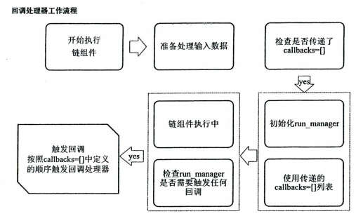

# 1.什么是回调处理器
回调处理器就是一种允许开发者在特定事件发生时执行自定义操作的机制。在
LangChain框架中，回调处理器是一种特殊的包装机制，其允许开发者定义一系列的
方法来响应不同的生命周期事件。每当特定事件被触发时，相应的回调处理器方法就
会被执行。

设计回调处理器的目的是提供一个统一、模块化和可重用的机制，使开发者能够
更轻松地为链组件和Agent组件添加各种回调功能。下面是使用回调处理器的几个好
处。
1. 模块化与可重用性：通过定义回调处理器，可以创建一组可重用的操作，并
且可以轻松地在不同的LangChain实例或应用中使用这些操作。例如，如果你有多
应用都需要流式输出到WebSocket，那么使用一个统一的WebSocketStreamingHandle
可以避免重复的代码。
2. 灵活性：回调处理器提供了一种结构化的方式来响应各种事件，而不仅仅是
流式输出。这意味着你可以为各种事件（如链开始、链结束、错误发生等）定义特定
的逻辑。
3. 与LangChain框架中的其他组件紧密集成：回调处理器是为LangChain框
架特别设计的，确保与其内部机制的兼容性和高效性。
4. 代码清晰且具有维护性：通过使用专门的回调处理器，你的代码结构会更清
晰。当其他开发者查看或维护你的代码时，他们可以轻松地找到和理解回调逻辑。

然而，是否使用回调处理器取决于业务需求。如果你发现直接在应用逻辑中实现
特定功能更适合你的需求，那么完全可以这样做。LangChain框架中的回调处理器只
是提供了一个方便、统一的工具，旨在简化开发者的工作。

## 1.1. 工作流程
整个流程包含开始执行链组件、链组件执行中、触发回调和完成4个阶段。

开始执行链组件阶段：此时，系统开始执行链组件，并为处理输人数据做好准备。
然后检查callbacks=[参数，若传递了callbacks=[]，则系统进人下一步初始化
run_manager。此时，系统使用传递的callbacks=[]列表来初始化run_manager，确保它
包含了所有提供的回调处理器。

链组件执行中阶段：系统根据输人数据执行链组件。在各个关键点，如数据处理、
模型调用等，系统会检查run_manager是否需要触发任何回调。

触发回调阶段：如果run_manager在某个执行阶段检测到需要触发的回调事件，
它会按照callbacks=[中定义的顺序触发回调处理器。

完成阶段：当所有任务都完成，并且所有必要的回调都被触发后，链组件的执行
就此结束。



# 自定义回调处理器
父类 BaseCallbackHandler

1. LLM事件

- on_llm_start：当LLM启动并开始处理请求时，这个方法会被调用。它提供了一
个机会，例如，初始化某些资源或记录开始时间。

- on_llm_new_token：当LLM生成一个新的令牌时，这个方法就会被执行。它在流
式处理中特别有用，其允许实时捕获和处理每一个生成的令牌。
- on_llm_end：当LLM完成任务并生成了完整的输出时，这个方法就会被调用。
它提供了一个机会进行清理操作或记录任务的完成时间。
- on_llm_error：如果在LLM处理过程中发生任何错误，则这个方法将会被执行。
可以在这个方法中添加错误日志或执行其他的错误处理操作。
2. 聊天模型事件
- on_chat_model_start：这个方法在ChatModel类模型包装器开始工作时被调用。
它提供了一个机会进行初始化操作或其他准备工作。
3. 链事件
- on_chain_start：当链开始执行时，这个方法会被调用。可以在这个方法中进行一
些初始化操作。
- on_chain_end：在链完成所有任务后，这个方法就会被执行。它提供了一个机会
进行清理操作或收集结果。
- on_chainerror：如果链在执行过程中遇到错误，则这个方法将会被调用。它许进
行错误处理或日志记录。
4. 工具事件
- on_tool_start：当工具开始执行任务时，这个方法就会被调用。
- on_tool_end：在工具成功完成任务后，这个方法就会被执行。
- on_tool_error：如果工具在执行过程中发生错误，则这个方法将会被执行。
5. 其他事件
- on_text：当需要处理任意文本时，这个方法会被调用。它提供了一个机会对文本
进行处理或分析。
- on_agent_action：当代理执行某个特定的操作时，这个方法就会被执行。
- on_agent_finish：在代理完成所有操作后，这个方法就会被调用。

## 简单示例
```python
class MyCallbackHandler(BaseCallbackHandler):
    def on_llm_start(self, serialized, prompts, kwargs):
        print("LLM has started!")
```
