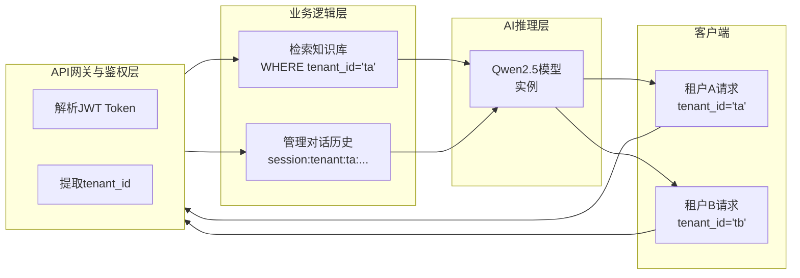

这是一个非常实际的问题。在智能客服系统中实现多租户数据隔离，核心就是确保租户A的客户永远看不到租户B的对话历史、知识库和任何数据。

要在你现有的Qwen2.5智能客服基础上实现这一点，通常有两种主流架构模式，我为你梳理了它们的区别：

| 维度 | 🏗️ 方案一：应用层逻辑隔离 | 🚢 方案二：物理环境隔离 |
| :--- | :--- | :--- |
| **核心思路** | 共享模型，用代码逻辑做“数据分区” | 租户独享独立环境，实现“物理分离” |
| **实现方式** | 在数据库、向量库、会话中加入`tenant_id`字段，所有查询强制过滤 | 每个租户运行独立的模型容器、数据库，甚至私有云 |
| **资源成本** | **低**，一套资源服务所有客户 | **高**，资源随租户数量线性增长 |
| **数据安全** | 中等（逻辑隔离） | **极高**（物理隔离），符合金融、医疗等合规要求 |
| **适用场景** | 标准SaaS服务，信任度高的普通企业客户 | 大客户、或对数据安全有极致要求的行业 |

考虑到大多数SaaS场景追求的是**成本与效率的平衡**，第一种“应用层逻辑隔离”是首选方案。下面我重点展开这个方案的Python实现细节。

---

### 🧩 核心架构：在应用层打好“租户标签”

这个方案的核心思路是“共享模型，隔离数据”。所有租户共用一套Qwen2.5模型和推理服务，但每个环节的数据都通过`tenant_id`进行强制隔离。

**整体数据流向如下：**



#### 1. 身份认证与租户识别

这是隔离的第一步。当租户的客户端（如网页或App）发起请求时，需要在请求头中携带身份凭证。你在后端需要从凭证中解析出当前是哪个租户在调用。

```python
# 在API网关或你的FastAPI中间件中实现
import jwt
from fastapi import HTTPException, Request

TENANT_SUPERSECRET = "your-256-bit-secret"

async def get_tenant_from_request(request: Request):
    # 1. 从请求头获取JWT Token
    auth_header = request.headers.get("Authorization")
    if not auth_header:
        raise HTTPException(status_code=401, detail="Missing token")
    
    # 2. 验证Token并解析出租户信息
    token = auth_header.split(" ")[1]
    try:
        payload = jwt.decode(token, TENANT_SUPERSECRET, algorithms=["HS256"])
        # 假设Token的payload中直接包含了tenant_id
        tenant_id = payload.get("tenant_id")
        if not tenant_id:
            raise HTTPException(status_code=403, detail="Invalid token: no tenant")
        return tenant_id
    except jwt.InvalidTokenError:
        raise HTTPException(status_code=401, detail="Invalid token")
```

#### 2. 向量数据库隔离

这是多租户隔离最关键的一环，直接决定了智能客服的“知识”会不会串味儿。你需要在存储文档向量时，就把`tenant_id`作为一个元数据字段存进去。检索时，用它作为过滤条件，确保只搜自己租户的知识库。

这里以业界流行的`Milvus`向量数据库为例，演示核心的过滤逻辑：

```python
from pymilvus import Collection, connections

# 假设已经连接了Milvus，并且有一个名为 'customer_service_kb' 的Collection
# 这个Collection有一个名为 'tenant_id' 的标量字段

def search_knowledge_base(tenant_id: str, query_vector: list, top_k: int = 5):
    """
    为特定租户检索相关知识
    """
    connections.connect("default", host="localhost", port="19530")
    collection = Collection("customer_service_kb")
    collection.load()

    # 关键点：定义搜索时的过滤表达式，强制限定 tenant_id
    search_expr = f'tenant_id == "{tenant_id}"'
    
    results = collection.search(
        data=[query_vector],  # 用户问题转换来的向量
        anns_field="embedding",  # 向量字段名
        param={"metric_type": "COSINE", "params": {"nprobe": 10}},
        limit=top_k,
        expr=search_expr,  # 在这里应用过滤规则
        output_fields=["content", "doc_id"]  # 返回原始文本内容
    )
    
    # 处理结果，返回给LLM作为上下文
    contexts = [hit.entity.get('content') for hit in results[0]]
    return contexts
```

#### 3. 对话历史隔离

为了保持连贯的对话体验，你需要为每个租户的每个会话（Session）独立存储历史记录。通常使用Redis，并采用带租户前缀的Key。

```python
import redis
import json

r = redis.Redis(host='localhost', port=6379, decode_responses=True)

def get_chat_history(tenant_id: str, session_id: str):
    """获取指定租户和会话的历史消息"""
    # 构建唯一的Key: qwen:chat:history:{tenant_id}:{session_id}
    history_key = f"qwen:chat:history:{tenant_id}:{session_id}"
    history = r.lrange(history_key, 0, -1)
    return [json.loads(msg) for msg in history]

def save_chat_message(tenant_id: str, session_id: str, role: str, content: str):
    """保存消息，并设置过期时间"""
    history_key = f"qwen:chat:history:{tenant_id}:{session_id}"
    message = json.dumps({"role": role, "content": content})
    r.rpush(history_key, message)
    # 设置过期时间，例如7天后自动清理
    r.expire(history_key, 60 * 60 * 24 * 7)
```

#### 4. 完整的客服接口实现

最后，将以上所有组件整合到一个API中，形成你智能客服的完整逻辑。

```python
from fastapi import FastAPI, Depends, HTTPException
from pydantic import BaseModel
from typing import List, Dict
import asyncio

app = FastAPI()

# 假设你已经有了一个Qwen模型的封装类
# from your_model_service import QwenModel
# model = QwenModel()

class ChatRequest(BaseModel):
    session_id: str
    message: str

class ChatResponse(BaseModel):
    answer: str

@app.post("/v1/chat", response_model=ChatResponse)
async def customer_service_chat(
    request: ChatRequest,
    tenant_id: str = Depends(get_tenant_from_request)  # 依赖注入，获取租户ID
):
    # 1. 获取该租户、该会话的历史记录
    history = get_chat_history(tenant_id, request.session_id)
    
    # 2. 将用户的新问题加入历史
    user_msg = {"role": "user", "content": request.message}
    history.append(user_msg)
    
    # 3. 如果需要RAG，使用tenant_id检索相关知识库
    # user_query_vector = model.embed(request.message)
    # contexts = search_knowledge_base(tenant_id, user_query_vector)
    # 然后将contexts作为system prompt的一部分或直接拼接到prompt中
    
    # 4. 调用Qwen2.5模型生成回复
    # 注意：需要将history传给模型，并确保模型只基于当前会话的上下文生成回复
    # ai_answer = model.chat(history)  # 这是简化的调用
    
    # 为了示例，这里模拟一个回复
    ai_answer = f"尊敬的租户 {tenant_id}，您好！您的问题是：'{request.message}'。这是一个模拟的AI回复。"
    
    # 5. 将AI的回复保存到历史
    ai_msg = {"role": "assistant", "content": ai_answer}
    save_chat_message(tenant_id, request.session_id, ai_msg["role"], ai_msg["content"])
    
    return ChatResponse(answer=ai_answer)

# 别忘了用 uvicorn 启动服务：uvicorn main:app --reload
```

---

### 📊 其他维度：成本与资源隔离

除了数据，你还可以考虑对资源进行更细粒度的控制，以保障服务质量：

*   **计算资源隔离**：对于资源消耗型任务（如大批量离线分析），可以像一些云平台那样，将不同租户的任务调度到不同的计算组或“车道”上。
*   **存储加密**：为每个租户生成独立的KMS（密钥管理服务）数据密钥。这样，即使存储介质被物理窃取，没有对应租户的密钥也无法解密数据。
*   **配额与限流**：为了防止某个租户滥用资源影响其他人，可以设置租户级别的限流规则。比如，限制租户A的QPS（每秒请求数）为10，Token消耗为1000/分钟。

---

### 💎 总结：技术是手段，架构看场景

总的来说，多租户隔离没有银弹，你需要根据业务阶段来选择：

*   **早期或标准SaaS**：优先采用 **“逻辑隔离”** 。它开发成本可控，一套架构就能支撑所有客户，是性价比最高的选择。
*   **有大客户或强合规需求**：则需考虑 **“物理隔离”** 。比如为大客户单独部署一套环境，或将整个服务部署在客户自己的私有云上。这种方式能满足金融、医疗等行业的严格监管，当然，成本和运维复杂度也会随之上升。

另外，在实现时务必确保隔离逻辑贯穿于身份认证、数据存储和模型调用的每一个环节，这样才能构建一个安全、可靠的SaaS化智能客服系统。